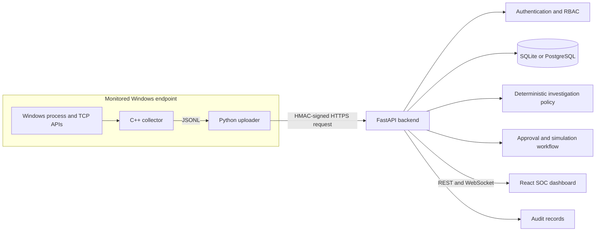

# AgentSec AI

AgentSec AI is an endpoint-security monitoring and incident-response platform
that combines a native Windows telemetry collector, authenticated event
ingestion, persistent security records, deterministic investigations, controlled
response approvals, and a React operations dashboard.

The project began as the AgentSec++ C++17 decision-engine exercise. The original
engine is preserved under `security-engine/` and has been extended with a real
Windows collector, Python event forwarding, a FastAPI control plane, dual
SQLite/PostgreSQL persistence, and a responsive frontend.

> **Verified scope:** the current investigation provider is deterministic
> policy logic—not an LLM threat analyst. The only verified response execution
> mode is simulation; it does not modify the operating system or send real
> notifications.

## Problem statement

Endpoint telemetry is useful only when it can be collected, authenticated,
normalized, stored, investigated, and presented to an operator without allowing
untrusted logs or automated recommendations to trigger unsafe host actions.
AgentSec AI demonstrates that complete local workflow with explicit trust
boundaries and auditable approvals.

## Key features

- C++17 Windows process and IPv4 TCP telemetry collection
- JSON Lines output and Python forwarding client
- One-time agent enrollment and per-agent signing key
- HMAC-SHA256 request authentication over the exact event body
- Five-minute timestamp window and database-backed nonce replay protection
- Separate per-agent event rate limit of 600 events per 60 seconds
- Password authentication, signed one-hour operator tokens, and RBAC
- SQLite persistence for local development and PostgreSQL support for production
- Severity/detection-driven incident creation
- Deterministic evidence-based investigation and recommendations
- Pending/approval/simulation response-action workflow
- Persistent user and agent audit records
- REST APIs, WebSocket live-event stream, and OpenAPI documentation
- React/TypeScript dashboard with API-backed empty and populated states

## Technology stack

| Layer | Technology |
|---|---|
| Endpoint collector | C++17, Win32 Toolhelp, Windows IP Helper API |
| Agent transport | Python 3 standard library, HMAC-SHA256 |
| Backend | Python, FastAPI, Pydantic, Uvicorn |
| Persistence | SQLite (local/CI) or PostgreSQL via Psycopg 3 (production) |
| Frontend | React, TypeScript, Vite, Recharts, Lucide |
| Runtime | Docker Desktop, Docker Compose, Nginx |
| CI | GitHub Actions, CMake, pytest, npm |

## Architecture



See [docs/ARCHITECTURE.md](docs/ARCHITECTURE.md) for detailed architecture,
ingestion, investigation, response, audit, and deployment diagrams.

## End-to-end workflow

1. `agentsec_collector` reads process and TCP tables and emits normalized JSONL.
2. `integrations/agent_uploader.py` compacts each JSON object.
3. The uploader hashes the exact body and signs timestamp, nonce, and hash.
4. The backend authenticates the agent and rejects stale or replayed requests.
5. A per-agent bucket enforces 600 event attempts per 60 seconds.
6. Pydantic validates event type, severity, sizes, and unknown fields.
7. Valid events and an audit record are committed to the configured database.
8. Detection events or events with severity 7+ create an incident.
9. An analyst/admin can create a deterministic investigation.
10. An analyst/admin can request a response; an admin must approve it.
11. Verified simulation records a result while making no OS change.

## Project structure

```text
AgentSec-AI/
├── backend/                 FastAPI application and tests
├── frontend/                React/TypeScript dashboard
├── security-engine/         Preserved engine and Windows collector
├── integrations/            Signed Python event uploader
├── docs/                    Architecture, API, security and verification
├── .github/workflows/       CI definition
├── docker-compose.yml
├── .env.example
└── CMakeLists.txt
```

## Configuration

Copy `.env.example` to `.env` and replace the example secrets. Never commit the
real `.env` file.

```env
AGENTSEC_ENV=development
AGENTSEC_DATABASE_PATH=./agentsec.db
AGENTSEC_SECRET_KEY=replace-with-at-least-32-random-bytes
AGENTSEC_BOOTSTRAP_ADMIN=admin
AGENTSEC_BOOTSTRAP_PASSWORD=replace-this-development-password
AGENTSEC_CORS_ORIGINS=http://localhost:5173,https://agentsec-ai.vercel.app
VITE_API_BASE_URL=https://agentsec-ai-backend-p08y.onrender.com
```

`AGENTSEC_LLM_PROVIDER` and `AGENTSEC_LLM_API_KEY` exist in configuration, but
the current investigation implementation does not call an LLM provider.

## Docker deployment

```powershell
Copy-Item .env.example .env
# Edit .env and replace every example credential.
docker compose config
docker compose up --build -d
docker compose ps
```

Local services:

- Dashboard: <http://localhost:5173>
- API: <http://localhost:8000>
- Swagger UI: <http://localhost:8000/docs>
- Health: <http://localhost:8000/health>

Expected health response:

```json
{"status":"ok","database":"ok"}
```

The default Compose deployment stores `/data/agentsec.db` in the `agentsec-data`
named volume. Set `DATABASE_URL` to use PostgreSQL for production; see
[docs/DEPLOYMENT.md](docs/DEPLOYMENT.md) for Supabase and Render configuration.

## Authentication and agent registration

Authenticate an operator:

```powershell
$login = Invoke-RestMethod -Method Post -Uri http://localhost:8000/api/v1/auth/login `
  -ContentType application/json `
  -Body (@{username="admin";password="<configured-password>"}|ConvertTo-Json)
$headers = @{Authorization="Bearer $($login.access_token)"}
```

Register an agent (admin only):

```powershell
$agent = Invoke-RestMethod -Method Post -Uri http://localhost:8000/api/v1/agents `
  -Headers $headers -ContentType application/json `
  -Body (@{name="windows-lab";platform="windows"}|ConvertTo-Json)
```

The enrollment response contains a one-time `signing_key`. Store it securely;
do not place it in source code, frontend configuration, screenshots, or logs.

## Windows collector

Build with CMake and Visual Studio Build Tools:

```powershell
cmake -S security-engine -B security-engine/build
cmake --build security-engine/build --config Release
security-engine\build\Release\agentsec_collector.exe --once
```

Or run an already-built local executable:

```powershell
security-engine\agentsec_collector.exe --once
```

Continuous collection uses a minimum five-second interval:

```powershell
security-engine\agentsec_collector.exe --interval 30
```

Forward a single snapshot:

```powershell
python integrations\agent_uploader.py `
  --collector security-engine\agentsec_collector.exe `
  --backend http://localhost:8000 `
  --agent-id <agent-uuid> `
  --signing-key <one-time-signing-key> `
  --once
```

The collector requires no documented administrator privilege for process
snapshots or `GetTcpTable2`; visibility may still be restricted by endpoint
policy. Collection failures are written to stderr.

## API summary

| Method | Route | Purpose |
|---|---|---|
| GET | `/health` | Backend/database health |
| POST | `/api/v1/auth/login` | Authenticate operator |
| POST | `/api/v1/agents` | Register agent (admin) |
| POST | `/api/v1/events` | Signed agent event ingestion |
| GET | `/api/v1/events` | Retrieve events |
| GET | `/api/v1/incidents` | List incidents |
| POST | `/api/v1/investigations` | Create investigation |
| POST | `/api/v1/actions` | Request response action |
| GET | `/api/v1/actions` | List response actions |
| POST | `/api/v1/actions/{action_id}/approve` | Approve action (admin) |
| GET | `/api/v1/audit` | Retrieve audit history (admin) |
| WS | `/ws/events?token=...` | Live event notifications |

There is no registered `GET /api/v1/agents`, incident-detail route, or
investigation-listing route. Full schemas are in
[docs/API_REFERENCE.md](docs/API_REFERENCE.md).

## Investigation engine

The verified provider is `deterministic-policy`. It queries events linked to an
incident, takes the maximum event severity, and classifies evidence as one of:

- `confirmed_malicious`
- `suspicious_unconfirmed`
- `benign`
- `insufficient_evidence`

Only structured `attributes.confirmed_indicator=true` can produce the confirmed
classification. Free-form descriptions remain untrusted evidence.

## Response workflow

Supported request types are `block_ip`, `terminate_process`, `quarantine_file`,
`disable_account`, and `notify`. Requests enter `pending`; only administrators
can approve them. The verified test used `notify` with `simulation=true` and
returned:

```json
{"executed":true,"mode":"simulation","message":"No operating-system change was made."}
```

No real notification was sent and no OS state was changed.

## Testing

```powershell
# Backend
Set-Location backend
python -m pytest -q

# Frontend
Set-Location ..\frontend
npm ci
npm run build

# C++
Set-Location ..
cmake -S . -B build
cmake --build build --config Release
ctest --test-dir build -C Release --output-on-failure
```

See [docs/TESTING_AND_VERIFICATION.md](docs/TESTING_AND_VERIFICATION.md) for
verified evidence, unexecuted tests, and limitations.

## Security considerations

- Treat event descriptions, paths, usernames, addresses, and attributes as
  untrusted input.
- Rotate server and agent secrets after suspected disclosure.
- Terminate TLS at a trusted reverse proxy before remote deployment.
- Do not expose SQLite, PostgreSQL, or Docker volumes directly to the Internet.
- Keep destructive response adapters disabled until separately designed,
  reviewed, and sandbox-tested.
- Session tokens currently use browser session storage; a same-site HttpOnly
  cookie/BFF design is preferable for an Internet-facing deployment.

See [docs/SECURITY_MODEL.md](docs/SECURITY_MODEL.md).

## Limitations and future work

- Deterministic investigation only; no verified LLM analysis
- PostgreSQL integration tests require a dedicated external PostgreSQL test database
- No verified automatic incident generation from newly collected network events
- No destructive response execution; simulation only
- No production-scale load or adversarial testing
- Additional Windows telemetry and RBAC boundary validation pending
- Dedicated replay-negative and container-restart persistence tests pending
- No Linux collector in the current source tree

See [docs/ROADMAP.md](docs/ROADMAP.md) for the completion matrix.

## Screenshots

Actual screenshots were not included in the verified source package. Suggested
future captures: login, overview, live events, incident list, investigation
result, response approval, and audit history.

## Author

**Shivansh Kumar**  
Portfolio: <https://shivanshonline.in>  
GitHub: <https://github.com/shivansh07adi-cloud>

