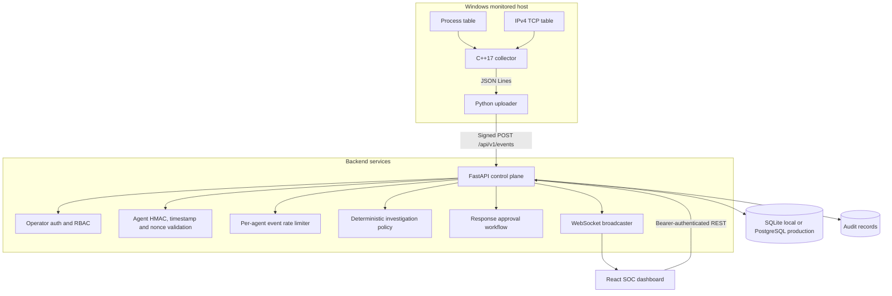
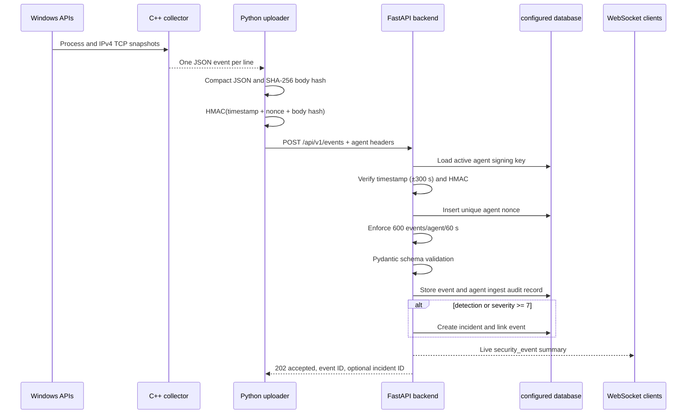
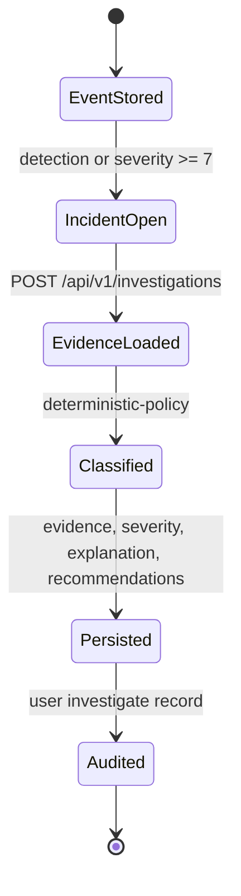
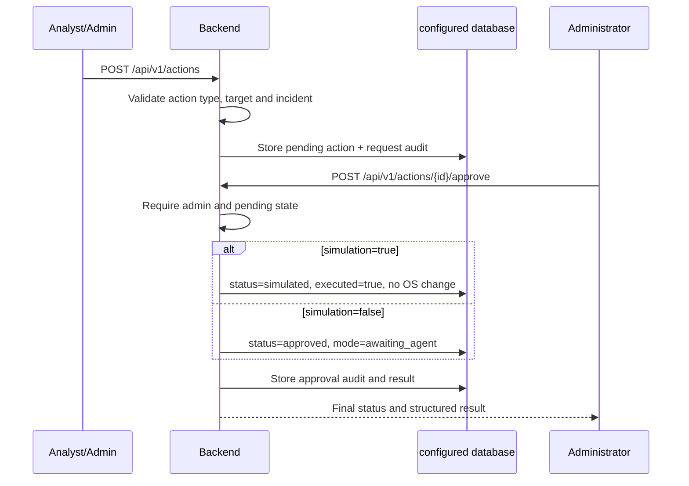
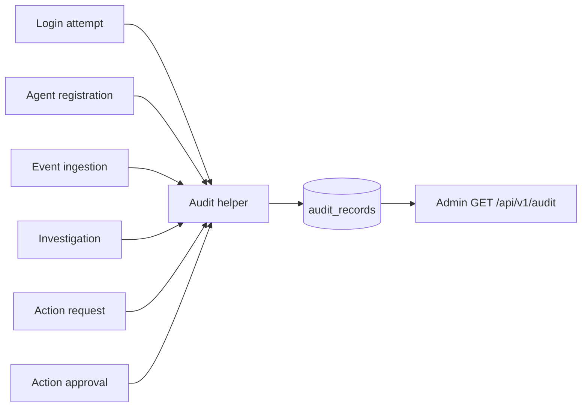
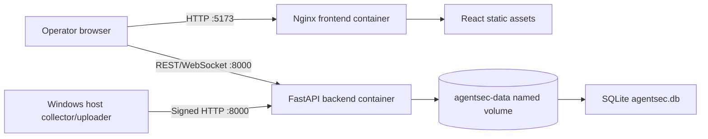

# AgentSec AI Architecture

## High-level system architecture

## Component responsibilities

| Component | Responsibility |
|---|---|
| React dashboard | Authenticates operators and displays API-backed events, incidents, actions, status and charts. |
| FastAPI backend | Validates identities and payloads, persists records, creates incidents, coordinates investigations/actions, streams event summaries. |
| Authentication/RBAC | PBKDF2 password verification; HMAC-signed one-hour tokens; `admin`, `analyst`, and `viewer` route gates. |
| Agent registration | Admin-only issuance of UUID and one-time signing material. Only `POST /api/v1/agents` exists. |
| C++ collector | Uses Toolhelp process snapshots and `GetTcpTable2`; emits normalized JSONL. |
| Python uploader | Runs the collector, compacts JSON and signs/sends each event independently. |
| SQLite/PostgreSQL | Stores users, agents, nonces, events, incidents, investigations, actions and audit records. |
| Investigation policy | Deterministically classifies linked evidence and generates bounded recommendations. |
| Response workflow | Records requests and admin approvals; verified execution is simulation only. |

## Endpoint event-ingestion sequence

The backend also applies a separate 120 requests per 60 seconds per client IP to
non-ingestion HTTP routes. Both limiters are in-memory and process-local.

## Incident investigation lifecycle

An investigation belongs to one incident. The policy loads at most 100 linked
events, sets severity to the maximum observed severity, and classifies evidence:

- `confirmed_malicious` only when structured `confirmed_indicator` is true
- `suspicious_unconfirmed` for severity 7+ or detection events
- `benign` when maximum severity is 0–2
- `insufficient_evidence` otherwise or when no events are linked

The verified investigation was ID 3 for incident 1, with event 1 as evidence,
severity 7, `suspicious_unconfirmed`, and provider `deterministic-policy`.

## Response-action approval workflow

The verified action was ID 1, incident 1, type `notify`, target
`security-team`, approved by user 1, and completed as a simulation. No real
notification or OS modification occurred.

## Audit logging flow

Each audit record stores actor type/ID, action, resource type/ID, JSON details,
and a UTC creation time. There is no cryptographic append-only chain.

## Deployment architecture

Compose builds two containers. The backend health check calls `/health`; the
frontend waits for that health check before starting. SQLite is persistent only
through the named volume and is intended for local/single-node operation.

## Trust boundaries

1. Endpoint events are untrusted even after transport authentication.
2. Agent HMAC proves possession of the signing key, not that telemetry is true.
3. Operator tokens authorize API use but are stored in browser session storage.
4. Deterministic recommendations never become executable commands.
5. Response simulation is the only verified executor.

